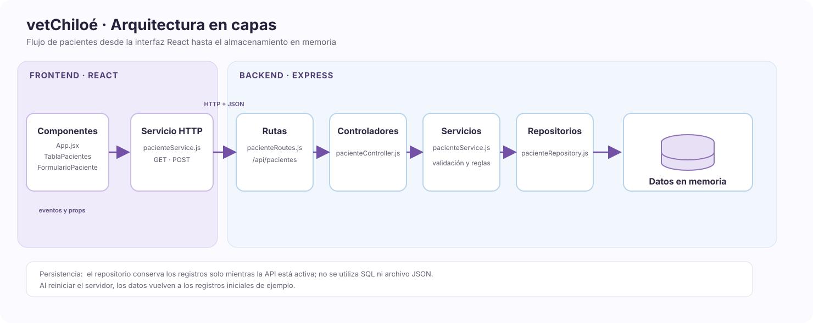

# vetChiloé

Sistema web para consultar y registrar pacientes de una clínica veterinaria. El frontend está hecho con React y Vite.

Este proyecto se desarrolla para la asignatura Tecnologías Web y Móviles de Ingeniería Civil en Informática, Universidad de Los Lagos.

## Tecnologías

El frontend usa React, Vite y CSS. El backend usa Node.js y Express. La API intercambia datos en formato JSON. Los pacientes se guardan en memoria mientras el servidor está activo; no se usa una base de datos SQL ni un archivo JSON.

## Funciones

- Listado y búsqueda de pacientes.
- Registro y edición de pacientes y sus dueños.
- Ficha clínica de cada paciente.
- Tema claro y oscuro.

## Estructura del proyecto

El frontend está organizado en componentes. El backend separa rutas, controladores, servicios y repositorio.

```text
vetChiloe/
├── docs/
│   └── diagrama-capas-vetchiloe.mmd  # Fuente editable de Mermaid
├── public/                     # Archivos estáticos públicos
├── src/
│   ├── assets/                 # Imágenes, diagramas y recursos multimedia
│   │   └── diagrama-capas-vetchiloe.svg
│   ├── components/             # Componentes modulares de React
│   │   ├── FichaClinica.css
│   │   ├── FichaClinica.jsx        # Vista de detalle (Carnet clínico)
│   │   ├── FlipCard.jsx            # Lógica de animación 3D (Framer Motion)
│   │   ├── FormularioPaciente.css
│   │   ├── FormularioPaciente.jsx  # Modal controlado para nuevos ingresos
│   │   ├── TablaPacientes.css
│   │   ├── TablaPacientes.jsx      # Tabla responsiva del dashboard principal
│   │   └── TarjetaPaciente.jsx     # Componente de lista (Fase UI anterior)
│   ├── services/
│   │   └── pacienteService.js      # Cliente HTTP de la API
│   ├── App.css                 # Estilos estructurales y globales
│   ├── App.jsx                 # Componente raíz y gestor del estado global
│   ├── index.css               # Reset y variables CSS globales
│   └── main.jsx                # Punto de entrada y montaje de React
├── server/
│   ├── src/
│   │   ├── controllers/         # Controladores HTTP
│   │   ├── repositories/        # Datos en memoria
│   │   ├── routes/              # Rutas de la API
│   │   └── services/            # Reglas de negocio
│   ├── package.json             # Dependencias y comandos del backend
│   ├── package-lock.json        # Versiones fijadas del backend
│   └── server.js                # Configuración y arranque de Express
├── .gitignore                  # Reglas de exclusión para GitHub
├── eslint.config.js            # Configuración de reglas de código limpio
├── index.html                  # Plantilla HTML principal
├── LICENSE                     # Licencia del código fuente (MIT)
├── package-lock.json           # Árbol de versiones exactas de dependencias
├── package.json                # Dependencias y scripts del proyecto (npm)
├── README.md                   # Documentación principal del repositorio
└── vite.config.js              # Configuración del empaquetador de Vite
```

## Diagrama de capas

El diagrama muestra el recorrido de una solicitud desde React hasta el repositorio del backend.



Fuente editable: [diagrama-capas-vetchiloe.mmd](./docs/diagrama-capas-vetchiloe.mmd).

## Trabajo y entrega

Para colaborar en el proyecto se pueden usar ramas y Pull Requests. Para esta entrega, según lo indicado en clases, se usa la rama `main` del fork personal. El historial de `main` conserva los commits descriptivos de cada capa.

## Requisitos

Se necesita Node.js y npm.

## Instalación y ejecución

Clona el fork e instala las dependencias del frontend:

```bash
git clone https://github.com/josenirou-dev/vetChiloe
cd vetChiloe
npm install
```

En una terminal, inicia el frontend:

```bash
npm run dev
```

En otra terminal, instala las dependencias del backend e inicia la API:

```bash
cd server
npm install
npm run dev
```

Vite comunica la interfaz con la API en `http://localhost:3000`. `GET /api/pacientes` devuelve el listado y `POST /api/pacientes` registra un paciente. El servicio valida que la especie sea Felino o Canino y genera el número de atención. Los registros se pierden al reiniciar el servidor. El formulario admite fotos de hasta 5 MB enviadas como JSON.

Para subir los commits al `main` del fork:

```bash
git switch main
git push origin main
```

La demostración consiste en comprobar que la tabla carga pacientes desde la API y que el formulario registra uno nuevo.

## Avance
- [x] Fase 1: Configuración inicial ([Vite](https://vite.dev/)) y componentización estática.
- [x] Fase 2: Integración de bibliotecas ( [Framer Motion](https://motion.dev/)) e interacciones 3D.
- [x] Fase 3: Levantamiento de estado, formularios controlados y renderizado de tablas.
- [ ] Fase 4: Mejoras de UX (Búsqueda en tiempo real, validaciones, Empty States, Skeleton Loaders).
- [x] Fase 5: Desarrollo de API RESTful en capas con [Node.js](https://nodejs.org/en) y [Express.js](https://expressjs.com/), con datos en memoria.
- [ ] Fase 6: Modelado y conexión a base de datos relacional ([PostgreSQL](https://www.postgresql.org/)).

## Licencia

Este proyecto usa la licencia MIT. Ver [LICENSE](LICENSE).